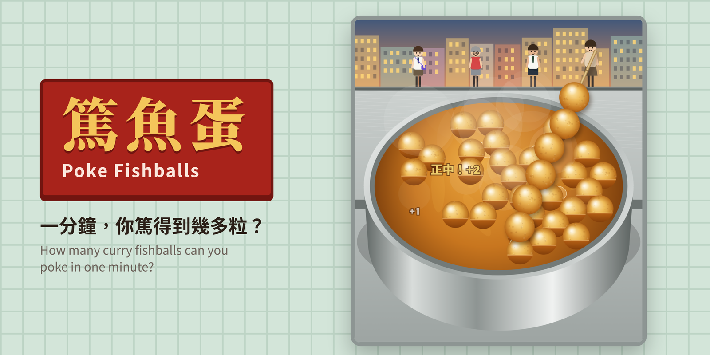

# 篤魚蛋 Poke Fishballs



**Mini games to poke the most fishballs in one minute.**

A one-minute browser game about a street-stall favourite: curry fishballs (咖喱魚蛋) on a bamboo stick. You run the stall. Poke as many fishballs as you can, fill each stick with six, and serve the queue before time runs out.

The game was inspired by the creator's childhood memory of buying curry fishballs after school in Macau.

---

## Contents

- [How to play](#how-to-play)
- [Rules](#rules)
- [Levels](#levels)
- [Scoring](#scoring)
- [Rank titles](#rank-titles)
- [Pausing and restarting](#pausing-and-restarting)
- [My games and deleting data](#my-games-and-deleting-data)
- [Sharing results](#sharing-results)
- [Sound](#sound)
- [Language](#language)
- [Devices and screen sizes](#devices-and-screen-sizes)
- [Privacy, data and security](#privacy-data-and-security)
- [Running the game](#running-the-game) and [putting it online](#putting-the-game-online-with-github-pages)
- [For developers](#for-developers)
- [Score benchmarks](#score-benchmarks)

---

## How to play

1. Pick a level on the start screen: **普通** or **挑戰**.
3. Tap **開檔！ Start**. You have **60 seconds**.
4. **Press** on a fishball in the pot to poke it with the bamboo stick.
5. **Release** to lift the stick, then press again to poke the next one.
6. When a stick has **6 items** on it, lifting the stick hands it to the next customer automatically, and you get a fresh stick.

Works with a mouse or a touch screen. The dots next to **呢串** show how many items are on the current stick and how each one went on: gold with a glow for a centre hit, orange for an off-centre hit (篤歪咗), red for a wrong item.

---

## Rules

### The stick

- **Every touch is one poke.** Even a very quick tap counts: the stick always finishes going down into the curry. Touches a little outside a fishball still count, so it works well with fingers on a phone.
- **Where you hit the item is where it sits on the stick.** Hit a fishball left of centre and it sits off to the side, so the stick looks crooked.
- A stick holds **6 items**. Once it's full, lifting it hands it over automatically.

### Hitting and missing

| What happens | Result |
|---|---|
| Poke within the centre 18% of a fishball's width (**正中**) | Fishball goes on the stick, worth 2 points |
| Poke elsewhere on a fishball | Fishball goes on the stick, worth 1 point, and sits crooked |
| Poke the outer edge of an item (more than 72% of the way from the centre) | It **slips away** (滑走咗) and is pushed aside. 0 points, nothing on the stick |
| Poke the curry but miss everything (**冇中**) | Nothing happens, apart from a ripple and a water-drop sound |
| Poke outside the pot (**篤空氣**) | Nothing happens |
| Poke an item that isn't a fishball (挑戰 only) | It goes on the stick and takes up a space, and you **lose 2 points** |

When items overlap, the poke hits the one in front.

### The pot

- Fishballs float and drift in every direction: a few eddies turn both ways and wander around the pot, and the whole pot swirls gently clockwise, then anticlockwise. The pattern starts differently each game.
- **Items don't stay forever.** Every item, fishball or not, floats for 8–15 seconds, bobs lower for a second, then sinks out of sight and can no longer be poked.
- **New items float up from the bottom of the pot**, anywhere in it, and can be poked once they reach the surface.
- Every poke pushes nearby items away with a ripple. Dragging the stick while it's down in the pot stirs the items around it.
- **The curry boils harder as time runs out.** It starts at a gentle simmer. Bubbles rise more and more often and bump the fishballs, and the current speeds up to 3.4× by the last second, the eddies churn and switch direction faster, and the items get jostled in random directions, so the last 20 seconds are the hardest. (The pot calms down again after the game.)
- The stall keeps topping up the pot: a new item rises up about every 0.25 seconds whenever the pot is below its target.

### Customers

- The queue is made up of everyday people: adults, office workers, grandparents, kids.
- The customer at the front of the queue talks to you during the game:

| When | Cantonese | English |
|---|---|---|
| You poke outside the pot | 唔好篤空氣啦 · 篤邊度呀？ · 喂，煲喺下面呀 · 空氣唔使錢㗎咩？ | Stop poking the air! · Where are you poking? · Hey, the pot's down there! · Is air free now? |
| You miss (sometimes) | 睇真啲先篤啦 · 又冇中？ · 魚蛋走晒去邊？ | Look before you poke! · Missed again? · Where did the fishballs go? |
| Nothing poked for 3.5 seconds | 快手啲 · 快啲啦，我趕時間 · 等到頸都長 · 師傅，好肚餓呀 · 仲未得呀？ | Hurry up! · Quick, I'm in a rush! · I've been waiting forever! · Boss, I'm starving! · Not ready yet? |

- When a stick is handed over, the customer reacts to it:

| Stick | Cantonese | English |
|---|---|---|
| Neat: fishballs close to the centre | 正呀！ · 好靚！ · 一流！ · 串得好靚仔 · 師傅好手勢！ | Perfect! · Beautiful! · Top class! · What a neat stick! · Nice hands, boss! |
| Average | 唔該！ · 多謝！ · 唔該晒 · 幾好吖 | Thanks! · Cheers! · Thanks a lot · Not bad |
| Crooked | 咁歪嘅… · 歪咗喎 · 歪到好似比薩斜塔咁 · 你篤得咁歪嘅？ · 串到成條蛇咁 | So crooked… · Bit wonky… · Leaning like the Tower of Pisa · How did it get this crooked? · Wiggly as a snake |
| Has something other than fishballs (挑戰) | 咁正！要魚蛋俾XX · 大佬，我要魚蛋喎 · 我要魚蛋呀！ · 點解有XX嘅？ · XX？我冇叫喎 | Great. I asked for fishballs and got XX · Boss, I wanted fishballs! · I wanted fishballs! · Why is there XX? · XX? I didn't order that! |

XX is the item poked by mistake: 白蘿蔔, 牛丸, 墨魚丸 or 豬皮 (white radish, beef ball, cuttlefish ball or pig skin). Each kind of comment repeats at most every 3 seconds. Reactions are for fun and don't change the score. All lines are in `js/i18n.js` (the `say.*` entries).

### Time

- Each game is **60 seconds**. The timer turns gold in the last 10 seconds.
- Fishballs left on a stick that hasn't been handed over when time runs out still count. Points are scored when an item is poked, not when the stick is handed over.

---

## Levels

| | 普通 (Normal) | 挑戰 (Challenge) |
|---|---|---|
| What's in the pot | Only fishballs | Fishballs mixed with 白蘿蔔 (white radish), 牛丸 (beef balls), 墨魚丸 (cuttlefish balls) and 豬皮 (pig skin) |
| Items in the pot | 30 | Starts at 34 and grows by 1 per stick, up to 44 |
| Share that isn't fishball | 0% | 50%: half fishballs, half other items |
| Extra drops | None | Every stick handed over drops 2 more non-fishball items into the pot |
| Curry current | Normal | 35% faster |
| Wrong items | Not possible | −2 points each, and it takes up a space on the stick |

In 挑戰, fishballs are always topped up first, so the pot always has at least 13 of them.

---

## Scoring

| Event | Points |
|---|---|
| Fishball poked off-centre | **+1** |
| Fishball poked dead centre (正中) | **+2** |
| Non-fishball item poked (挑戰 only) | **−2** (and it uses up a space on the stick) |
| Slip, miss, or poking outside the pot | 0 |

- Your score never goes below 0.

The result screen shows your score, sticks served, fishballs poked, centre hits, slips, wrong items (挑戰), and your personal best.

---

## Rank titles

Shown at the end of each game:

| Title | 普通 | 挑戰 |
|---|---|---|
| 傳說級魚蛋佬 | 320+ | 240+ |
| 魚蛋師傅 | 240+ | 180+ |
| 熟手學徒 | 160+ | 120+ |
| 新嚟幫手 | 80+ | 60+ |
| 篤到手軟 | under 80 | under 60 |

---

## Pausing and restarting

- Press the **pause** button (two bars) in the top bar during a game. It turns into a play button while paused. **Esc** or **P** on a keyboard also work.
- The game pauses on its own if you switch to another app or tab.
- While paused, the clock and the pot are frozen. The pause screen shows the level, time left and score, with three choices:
  - **繼續**: carry on.
  - **重新開始**: restart the same level from 60 seconds.
  - **返主頁**: back to the start screen. That game is **not** saved.
- After a game, **再篤過** replays the same level and **換關卡** goes back to pick a level.

---

## My games and deleting data

It's a single-player game, so there are no names or accounts.

### My games (我嘅紀錄)

There's no leaderboard. **我嘅紀錄 / My games** (top-right button, or on the result screen) shows the player's own games on this device, **ranked by score, best first**:

- Switch between 普通 and 挑戰.
- Summary: games played, best score and average score for that level.
- Each game shows its rank, then its **score**, with its rank title (e.g. 魚蛋師傅) at the top right. Underneath, in tiny text: how many fishballs and sticks on the left, and the date and time in the bottom-right corner.
- The game just played is highlighted.
- To compare with friends, share the result text or image (see below).

### Where records are kept

**Everything stays in the browser on the player's device.** Nothing is ever uploaded: there's no server, no account and no online database.

| Stored on the device | What it holds |
|---|---|
| `fishball-history` | The last 50 games: level, score, stats and date |
| `fishball-lang` | Cantonese or English |

Records don't move between devices or browsers.

### Deleting your data

Two ways, and both remove everything:

1. **In the game:** open **我嘅紀錄**, tap **刪除所有紀錄 / Delete all records**, then **確定刪除 / Delete** to confirm, or **取消 / Cancel**. All games and the language choice are erased from the browser.
2. **In the browser:** clear the site data for the game's address (for example, in Chrome: Settings → Privacy → Site data; on iPhone: Settings → Safari → Advanced → Website Data).

Deleted data can't be recovered.

---

## Sharing results

On the result screen:

- **分享成績** opens the phone's share sheet, or copies a message like this, ready to paste into a chat:
  > 我喺「篤魚蛋」挑戰關一分鐘攞咗 172 分！篤咗 103 粒魚蛋，交咗 18 串，正中 76 次。你破唔破到？
  >
  > followed by the game link

  If copying isn't allowed, the text appears in a box to copy by hand.
- **儲存成績圖** saves a square result image with your score, level and stats.

The link in the message is the game's GitHub Pages address (`SHARE_URL` in `js/config.js`). Anyone can open it; no account needed. When the link is pasted into most chat apps, it shows the thumbnail image as a preview.

---

## Sound

| Moment | Sound |
|---|---|
| Background music | An original track made in code: a driving beat (drums, pumping bass, soft held chords) with no melody, in a bright major key (C – G – Am – F twice, with the top notes running C G A F · E G A F; 124 bpm). During a game only, at the same tempo throughout. It stays in the same key throughout, and gets more intense as time runs out: busier hi-hats from 20 seconds, snare rolls and a ticking clock in the last 10. It stops on pause and at the end. |
| Centre hit | A clean poke and a bright, rising "ting-ting!", and a gold **正中！+2** |
| Off-centre hit | A dull, wobbly "bonk" with no chime, and an orange **篤歪咗 +1** |
| Slipped off (篤太邊) | A wet sliding "shhhwip" and a little splash |
| Wrong item (挑戰) | A buzzer, "eh-eh" |
| New item reaches the surface | A soft "bloop" |
| Stick handed over | A whoosh as the stick flies over |
| Customer gets a neat stick | Cash-drawer "ka-ching" and a rising run of bells (with a sparkle for a very neat stick) |
| Customer gets a crooked stick or a wrong item | A sad "wah-wah" |
| Miss into the curry | Water-drop "plip" with a tiny splash |
| Poking outside the pot | Silent |

The **speaker** button turns all sound and music on or off; it shows a crossed-out speaker while muted. Sound starts after the first tap, as browsers require. On iPhone, the side silent switch also mutes the game.

---

## Language

- The **EN / 粵** button, at the top right of every pop-up (instructions, pause, result, 我嘅紀錄), switches the whole game between Cantonese (Traditional Chinese) and English: every screen, button, pop-up message, customer line, rank title, share message and result image.
- The game always starts in Cantonese. If the player switches to English, it remembers that choice on that device.
- All text lives in `js/i18n.js`. To change a word, edit it there.

---

## Devices and screen sizes

The game runs in any modern web browser. Nothing to install.

| Platform | Supported browsers |
|---|---|
| iPhone / iPad | Safari, Chrome and others (iOS / iPadOS 15 or newer) |
| Android phones and tablets | Chrome, Samsung Internet, Firefox (Android 8 or newer, current browser) |
| Desktop | Chrome, Edge, Safari, Firefox (current versions) |

Works with touch, mouse or pen. On a keyboard, Esc or P pauses.

**Screen layouts**

- **All layouts:** the title is on the left, with time, score and sticks always in the top-right corner. The buttons (pause, sound, my games) line up on the right.
- **Phones held upright:** the top bar and buttons sit above the pot. On narrow phones (320 px wide, like iPhone SE), the buttons wrap onto a second line, still aligned right.
- **Phones held sideways:** the score and buttons move into a column on the left, and the pot fills the rest of the screen.
- **Tablets and desktops:** the game sits in a centred column up to 760 px wide.
- The pot, items and customers redraw to fit whenever the screen size or orientation changes.

Tested by emulating these screens in Chromium: iPhone SE, iPhone 15 Pro Max, iPhone 15 sideways, Pixel 7 upright and sideways, Galaxy S9+, iPad Pro 11 upright and sideways, desktop at 1440×900 and 1024×640, and a 320×568 phone. None scroll sideways or up and down. Pop-ups cover the whole screen, and one that is too tall is shrunk to fit instead of scrolling (only the list of games in 我嘅紀錄 scrolls inside its card).

Not yet tested on real Safari, the browser engine used on every iPhone and iPad. A real-device check before launch is recommended.

**Phone details handled**

- No double-tap zoom, no long-press menus, and no text selection while playing.
- No pull-to-refresh while dragging the stick.
- Sound starts on the first tap, as iOS requires, and comes back after a phone call or app switch.
- Leaving the app or tab pauses the game automatically.
- Layouts respect the iPhone notch and home bar.

---

## Privacy, data and security

### Outside services the game contacts

| Service | Why | What it receives |
|---|---|---|
| Google Fonts (`fonts.googleapis.com`, `fonts.gstatic.com`) | Downloads the two Chinese fonts | The player's IP address and browser details, as with any web font. No game data. |

Google Fonts is the only outside service. GitHub Pages hosts the files, and GitHub sees normal web traffic, like any website host.

There are no analytics, ads, tracking pixels, cookies, accounts, API keys or passwords anywhere in the code. The game doesn't use the camera, microphone, location, contacts or photos.

### What is stored

Only the two items in the player's own browser listed under [Where records are kept](#where-records-are-kept). Nothing is sent anywhere.

### Browser features used, only when the player taps

- **Clipboard:** copies the share message. The game only writes; it never reads the clipboard.
- **Share sheet:** on phones that support it.
- **File download:** saves the result image. The player confirms first.

### Things to be aware of

- **Records are per device.** A new phone, another browser, or clearing site data starts from zero.
- **Private browsing:** some browsers forget local storage when a private window closes, so those games aren't kept.
- **Google Fonts:** if you'd rather the game contacted no outside service at all, the fonts can be bundled with the game instead.

---

## Running the game

- **Online:** the game's GitHub Pages address, `https://ulouwm.github.io/poke_fishballs/`, once Pages is turned on (below). Anyone can play; no account needed.
- **Locally:** open `index.html` in any modern browser on desktop or phone. There's no build step and nothing to install. Fonts load from Google Fonts, with system fonts as a fallback.

### Putting the game online with GitHub Pages

1. Make sure the game is on the `main` branch.
2. On GitHub, open the repository's **Settings → Pages**.
3. Under "Build and deployment", choose **Deploy from a branch**, branch `main`, folder `/ (root)`, and save.
4. After a minute or two the game is live at `https://ulouwm.github.io/poke_fishballs/`. Share that address with anyone.

Free GitHub Pages needs the repository to be **public**. Updates go live automatically a minute or so after each change is merged into `main`.

---

## For developers

### Files

```
assets/thumbnail.png  image at the top of this README (also usable as the GitHub social preview)
index.html        page structure: top bar, start / result / pause / my-games screens
css/style.css     all colours, fonts and layout (including phone and sideways layouts)
js/config.js      game settings: time, scoring, levels, share link
js/i18n.js        every on-screen text in Cantonese and English, and the language switch
js/state.js       page elements, small helpers, live game state
js/records.js     my games (ranked), deleting data
js/share.js       share text and result image
js/sound.js       sound effects and background music
js/layout.js      fitting the scene to the screen, street background
js/items.js       what's in the pot: item artwork, which items appear, floating physics
js/poke.js        poking, hits and misses, scoring, handing sticks to customers
js/customers.js   the queue of customers: looks and reactions
js/draw.js        drawing each frame: stick, pot, items, steam
js/game.js        main loop, controls, start / pause / end of a game, start-up
```

Where to look for common changes:

| To change… | Edit |
|---|---|
| Game length, points, penalty, refill speed, boil strength, level settings, share link | `js/config.js` |
| Any text in either language (screens, buttons, messages, customer lines, rank titles) | `js/i18n.js` |
| Colours, fonts, button styles | `css/style.css` |
| My games screen, deleting data | `js/records.js` |
| What customers say | `js/i18n.js` (`say.*`) |
| When customers speak | `js/poke.js`, `js/game.js` (impatience), `js/customers.js` (`customerSay`) |
| How customers look | `js/customers.js` |
| How fishballs and other items look | `js/items.js` (`paintItem`) |
| Sounds | `js/sound.js` |
| Rank title score thresholds | `js/game.js` (`rankFor`) |

The scripts are plain scripts, not modules, so the game works when you double-click `index.html`. They load in the order listed in `index.html`. Each file can use anything the files before it defined, so keep that order when adding files.

### Tuning values

All in `js/config.js`:

| Constant | Value | Meaning |
|---|---|---|
| `GAME_TIME` | 60 | Seconds per game |
| `STICK_CAP` | 6 | Items per stick |
| `CENTER_BONUS` | 1 | Extra point for a centre hit |
| `WRONG_PENALTY` | 2 | Points lost for a non-fishball item |
| `REFILL_EVERY` | 0.25 | Seconds between items dropped into the pot |
| `BOIL_MAX` | 3.4 | How much faster the curry moves at the last second than at the start |
| `LEVELS.normal` | 30 items, 0% other items | 普通 settings |
| `LEVELS.hard` | 34→44 items, 50% other items, 1.35× current, +2 items per stick | 挑戰 settings |
| `HISTORY_MAX` | 50 | Games kept in personal history |
| `SHARE_URL` | GitHub Pages address | Link added to shared results |

---

## Score benchmarks

Measured by a bot playing the real game for 60 seconds. The human rows are simulated players with different aiming speeds. For 挑戰, they also take extra time to recognise each item (0.08–0.25 s) and occasionally pick the wrong one (3–12%). Treat them as estimates of what people can do, not measured scores.

| Player | 普通 | 挑戰 |
|---|---|---|
| Frame-perfect bot (limited by how fast the pot refills) | ~500 | ~463 |
| Elite human (~0.18 s to aim each poke) | ~363 | ~238 |
| Skilled human (~0.3 s) | ~270 | ~161 |
| Casual player (~0.55 s) | ~135 | ~60 |

A score close to the bot's ceiling is very unlikely from a person.
